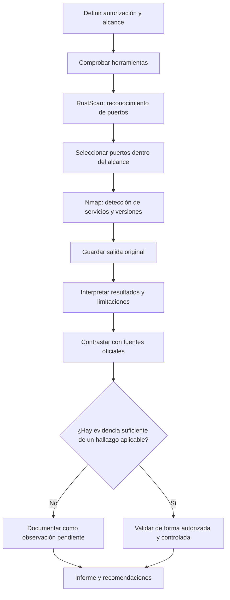

# Flujo de trabajo: RustScan + Nmap

Este diagrama resume el flujo documentado en la práctica. Debe aplicarse únicamente a objetivos propios o autorizados.

## Cómo leer el flujo

1. **Alcance:** definir el sistema y las pruebas permitidas antes de empezar.
2. **Reconocimiento:** RustScan localiza puertos abiertos.
3. **Enumeración:** Nmap intenta identificar servicios y versiones.
4. **Trazabilidad:** conservar los comandos y la salida original.
5. **Análisis:** contrastar versiones y contexto; no convertir automáticamente un puerto abierto en una vulnerabilidad.
6. **Informe:** distinguir hechos observados, hipótesis y hallazgos validados.

## Aplicación a la práctica

En la prueba documentada contra `scanme.nmap.org` se observaron los puertos TCP 22, 80 y 9929. La ejecución final identificó OpenSSH 6.6.1p1, Apache httpd 2.4.7 y Nping echo. Esos datos son observaciones de una ejecución concreta, no una confirmación de explotación.
